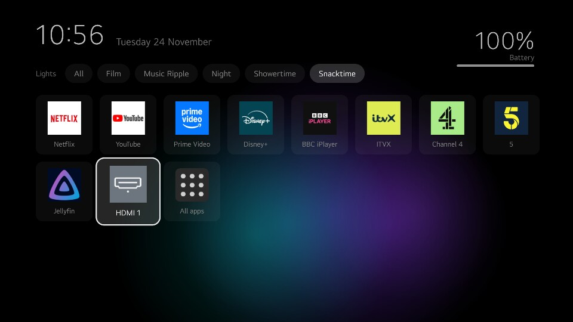

# A custom home screen for a rooted LG webOS TV



A replacement for LG's Home screen, built as a **QML app** (run by LG's own `qml-runner`) and wired in so that it is
what you get **at power-on** and when you **press Home** - with no LG home screen, ads or promotions in between.

What it looks like and does:

- A grid of app tiles (Netflix, YouTube, Live TV, HDMI inputs, Settings... whatever you choose), a large quiet
  clock, and optional Home Assistant bits (a read-out of any entity you choose - battery, temperature, power, a state - and a row of light-preset buttons).
- Pure black background with slow, dim purple and teal glows (OLED-friendly: nothing stays lit in
  one place, it dims further after 5 minutes of no input, and the whole layout drifts a few pixels every few
  minutes).
- Works with the arrow keys + OK **and** the Magic Remote pointer (hover to focus, click to open).
- **Yellow** (or hold OK) edits the home screen; **Back** on the home screen opens an **Open apps** list where OK
  closes an app; an **All apps** page lists everything installed, live.
- Optional extras described below: switching off LG's logging/analytics services and blocking LG's
  firmware-update servers (so the "update available" popup stops).

It was built and tested on **one TV only**: an LG OLED on **webOS 9.2.1** (product `webOSTV 7.0`, firmware
23.21.20, UK/EU). Other models and firmware may behave differently - see "Things that may differ on your TV".

> **Read this first.** This needs a **rooted** TV. Rooting, and everything here, is unsupported by LG,
> voids your warranty, and can go wrong. Nothing in this repo roots a TV for you. Every change below
> can be undone over SSH (see "Undo everything"), but if you lose SSH access you cannot undo anything -
> so don't skip the "keep a way back" steps. **A firmware update will remove root** (and with it all of
> this); read "Firmware updates" before you ever press Yes on an update popup.

---

## Contents

1. [What you need](#1-what-you-need)
2. [How it works (the short version)](#2-how-it-works-the-short-version)
3. [Step 1 - Install the launcher as an app](#3-step-1---install-the-launcher-as-an-app)
4. [Step 2 - Make the Home button open it](#4-step-2---make-the-home-button-open-it)
5. [Step 3 - Make power-on open it (optional)](#5-step-3---make-power-on-open-it-optional)
6. [Optional - telemetry and update blocking](#6-optional---telemetry-and-update-blocking)
7. [Undo everything](#7-undo-everything)
8. [Firmware updates](#8-firmware-updates)
9. [Things that may differ on your TV](#9-things-that-may-differ-on-your-tv)
10. [Troubleshooting and handy commands](#10-troubleshooting-and-handy-commands)
11. [What's in this folder](#11-whats-in-this-folder)
12. [What we learned / credits](#12-what-we-learned--credits)

---

## 1. What you need

- **A rooted LG webOS TV with the Homebrew Channel installed and root SSH working.** See
  <https://www.webosbrew.org/> (and the Homebrew Channel project) for how to root your model/firmware, and
  check that your exact model and firmware version are supported before you start.
- Homebrew Channel's SSH server should be enabled. The default login is **user `root`, password `alpine`** -
  **change it, or better install your SSH key and turn password login off** (see below).
- A PC on the same network with:
  - `ssh` and `scp` (Windows 10/11 has them; Git Bash is the easiest way to run the `.sh` scripts here),
  - **Node.js** (used to build the install package and to read app lists),
  - a bash shell (Git Bash, WSL, macOS or Linux terminal).
- The TV's IP address (give it a fixed lease in your router so it doesn't change).
- Optional: Home Assistant, if you want the read-out and light-preset widgets.

Install your SSH key on the TV so the scripts can log in without a password:

```bash
ssh root@<TV_IP>                       # password: alpine (default)
mkdir -p /home/root/.ssh && chmod 700 /home/root/.ssh
echo "<contents of your id_ed25519.pub>" >> /home/root/.ssh/authorized_keys
chmod 600 /home/root/.ssh/authorized_keys
exit
ssh -o BatchMode=yes root@<TV_IP> echo key login works     # must work without a password prompt
```

(`deploy.sh` uses `BatchMode`, so it needs key login. Leave password login enabled while you are setting
things up - it is your safety net.)

## 2. How it works (the short version)

The pieces, from least to most invasive:

| Piece | What it is | Where it lives on the TV |
|---|---|---|
| **The launcher** | A QML app (`com.ha-launcher.home`) installed as an `.ipk` through the TV's own installer, run by LG's `qml-runner` | `/media/developer/apps/usr/palm/applications/com.ha-launcher.home` |
| **Home stand-in** (`home-shim.sh`) | A tiny script *bind-mounted over* LG's `/usr/bin/com.webos.app.home`. When the TV "launches Home" it runs our script, which opens the launcher instead. LG's Home never starts. | `/var/lib/ha-launcher/home-shim.sh` |
| **Boot hook** (`00-home-launcher`) | Runs at boot (via Homebrew Channel's `init.d`) and puts the stand-in in place | `/var/lib/webosbrew/init.d/` |
| **Boot override** (`bootd-override.sh`) | Tells the TV's boot manager that the *first app* after power-on is the launcher | `/var/luna/preferences/bootd.json` |
| **Telemetry / update blocks** | Stops LG's logging services; blocks LG's update servers | `init.d` scripts, plus optionally your router |

Why a bind-mount stand-in? LG's Home is a native app on a **read-only** firmware image, so you can't edit
it. But you *can* mount your own file over the path it is launched from - and unlike the other
approaches we tried, it needs no key hooking, so Home is instant and there is no flash of LG's screen.

The stand-in has **fail-safes**: if the launcher can't be launched, if Home is launched more than 6 times in
10 seconds (a loop), or if a "disabled" flag file exists, it unmounts itself and runs the real LG Home.

## 3. Step 1 - Install the launcher as an app

This step changes nothing about your Home button - you open the launcher from the app list. It is the safe
part, so get this working first.

### Point the scripts at your TV

```bash
export TV=root@<TV_IP>          # e.g. root@192.168.1.50
```

**Apps:** the first-run home screen and "Reset home screen" come from `qml/Defaults.js` (a list of `{id, title, icon}`),
with the icons bundled in `qml/icons/`. Find app ids with `list-apps.js`. Day to day you change the home screen on the TV with the remote (Yellow / hold OK).

**Home Assistant (optional):** copy `ha.js.example` to `ha.js`, fill it in (URL, a long-lived access token, any read-only entity to show top-right, plus an optional label, a select entity for the light presets) and put it **on the TV only**: `ssh $TV mkdir -p /var/lib/ha-launcher && scp ha.js $TV:/var/lib/ha-launcher/ha.js`, then delete your local copy. `deploy.sh` reads
that file **on the TV** and generates `qml/cfg.js` there, so the token never sits in this folder. The QML version polls
Home Assistant over plain HTTP every 25 seconds while it is on screen (LG's Qt has no WebSocket module), so Home Assistant
must be reachable from the TV.

The top-right read-out (`sensor` in `ha.js`) can be **any read-only entity**: a sensor (battery, temperature, power, humidity...), a
`binary_sensor`, an `input_number`, even a text state such as `home`. The launcher asks Home Assistant for the entity's state
and shows the value with the **unit Home Assistant reports** (`unit_of_measurement`), with the entity's friendly name under it
(or your own `label`). A `%` unit also draws a bar, and a sensor whose `device_class` is `battery` turns amber below 25% and red
below 10%. Leave `sensor` empty and nothing is shown there. The chips row (`preset`, any `select` / `input_select` entity) is headed by the entity's friendly name, or by `presetLabel` if you set one. With no `sensor` and no `preset` the tile grid moves up under the clock to close the gap. (An older `battery:` setting is still accepted in place of `sensor:`.)

**Install (does not start it):**

```bash
./deploy.sh
ssh $TV 'sh -s' <<'EOF'
luna-send -n 1 luna://com.webos.applicationManager/launch '{"id":"com.ha-launcher.home"}'
EOF
```

`deploy.sh` builds the `.ipk`, installs it, and then does what the installer does *not* do for QML apps - without
these the app runs but every call to the TV silently gets no answer:

1. writes a **luna role file** (`/var/luna-service2-dev/roles.d/com.ha-launcher.home.app.json`) and adds `roleFiles` to the
   app's **manifest** (`/var/luna-service2-dev/manifests.d/com.ha-launcher.home.json`);
2. writes an `applications.internal` **permission** for the app (needed for the app list, closing apps and asking what is
   in the foreground) - a real permission grant: the launcher can then call LG's internal app-management functions. It is
   your own code on your own rooted TV, but understand it before doing it;
3. runs `ls-control scan-services`.

It redoes all of that on every run, because an install resets it.

**Making Back work (the important QML trick).** LG's key filter shows its own "Do you want to exit the app?" box whenever
Back is pressed in an app whose window has not declared that it handles Back itself. Web apps declare this automatically;
a QML app must set the window property `_WEBOS_ACCESS_POLICY_KEYS_BACK` to `"true"`. In our testing the only way that
works from QML is an **in-place write** on the window object:

```qml
win.windowProperties["_WEBOS_ACCESS_POLICY_KEYS_BACK"] = "true"
```

(`setWindowProperty()` and `updateWindowProperties()` are not callable from QML, and assigning a new map to
`windowProperties` fails because it is read-only. We found the working form in the open-source
[ratelimits/atlauncher](https://github.com/ratelimits/atlauncher) and confirmed it on our TV.) `main.qml` does this when
the window appears and again when it becomes active. Two follow-ups:

- With the policy set, Back arrives as Qt key `0x1200003` (native scan code 420), not the 412 seen without it. The app
  accepts both.
- **Yellow** arrives as Qt key `0x1200013` (scan 408) and only reaches the app if the window asks for it:
  `keyMask: WebOSWindow.KeyMaskDefault | WebOSWindow.KeyMaskBack | WebOSWindow.KeyMaskRemoteColorYellow`.

`appinfo.json` also sets `noSplashOnLaunch`, `disableBackHistoryAPI`, `handleScreenRemoteKey`, `handleExitKey` and
`defaultWindowType: card`.

**Open apps panel (Back on the home screen):** lists apps that have been in the foreground since you first used the
launcher (LG keeps preloaded apps "running" in the background that you never opened, so the raw running list would be
misleading); pick one and OK closes it. It is tracked from `getForegroundAppInfo` and saved on the TV.

**Testing without a screen:** QML runs headless with
`QT_QPA_PLATFORM=offscreen qml-runner '{"appId":"...","main":"file:///...","params":{}}' </dev/null` (use a plain `Window`
instead of `WebOSWindow`, which crashes offscreen). To see the real thing, take a screenshot (see Troubleshooting).

### Open it

You should now see the launcher. Test the arrow keys, OK, and the Magic Remote pointer.

### The "All apps" page

The last tile on the home grid, **All apps**, opens a scrollable page listing every app the TV knows about, sorted by
name, with a **Back** chip (Up from the first row) and the remote's **Back** key, both of which return to the main page.
The list is read **live from the TV each time the page opens** (`applicationManager/listLaunchPoints`), so newly installed
apps appear without changing anything - there is no saved copy. If the TV won't answer, the page says so instead of showing
stale data. It needs the `applications.internal` permission that `deploy.sh` grants.

### Adding, removing and moving apps on the home screen

`qml/Defaults.js` is only the **default** home screen. You change it on the TV itself:

- **On the home screen**, press **Yellow** on a tile (or hold OK on it with the Magic Remote; a long click with the
  pointer does the same) to get a small menu: **Move** (arrow keys shuffle the tile, OK drops it), **Remove from home
  screen**, **Reset home screen to the default apps**, or **Cancel**.
- **On the All apps page**, press **Yellow** or hold OK on any app: **Add to home screen** or **Remove from home screen**.
  Apps that are already on the home screen have a small teal dot.
- The home screen holds up to 23 apps (8 columns x 3 rows, with the "All apps" tile taking the last slot). When it is full,
  it tells you to remove one first.

Your layout is stored in the app's own local storage on the TV (`home` = ordered app ids, `info` = title/icon of pinned
apps that aren't in `Defaults.js`), so it survives reboots and re-installs, but **not** uninstalling the launcher or
clearing its data. New apps never appear on the home screen by themselves - only in All apps until you add them. If your
remote has no coloured buttons, use the long-press.

## 4. Step 2 - Make the Home button open it

Now the real replacement. Do this only after Step 1 works.

Copy the stand-in, its off-switch and the boot hook onto the TV:

```bash
ssh $TV mkdir -p /var/lib/ha-launcher
scp home-shim.sh home-shim-off.sh $TV:/var/lib/ha-launcher/
scp 00-home-launcher $TV:/var/lib/webosbrew/init.d/
ssh $TV 'chmod 755 /var/lib/ha-launcher/home-shim.sh /var/lib/ha-launcher/home-shim-off.sh /var/lib/webosbrew/init.d/00-home-launcher'
```

If your TV's SSH server has no `scp`/SFTP support (some devices don't), pipe the file through ssh instead:
`ssh $TV 'cat > /path/to/file' < localfile`.

Try it **by hand first, without rebooting**, so a mistake disappears on the next reboot:

```bash
ssh $TV 'sh /var/lib/webosbrew/init.d/00-home-launcher'      # mounts the stand-in and kills LG Home
```

Now press **Home** on the remote from some other app. The launcher should open straight away with no
flash of LG's screen. If something is wrong, remove it at once:

```bash
ssh $TV 'sh /var/lib/ha-launcher/home-shim-off.sh'          # restores LG's Home immediately
```

Once you're happy, **reboot the TV**. Homebrew Channel runs everything in `/var/lib/webosbrew/init.d/` at boot,
so the stand-in will be back automatically.

**Good to know**

- **Timing (cold boot only):** LG's Home is preloaded at ~7 s, the launcher is first app from ~30 s (Step 3), and
  Homebrew's boot hook runs at **~40-50 s**; nothing user-controlled runs earlier (the systemd units are read-only
  and `bootd.json` can only pick the first app). So a Home press before ~30 s gives LG's Home; from ~30 s to the hook
  it gives LG's Home briefly (see below); after the hook it's always the launcher. Standby/wake is unaffected.
  The launcher also watches the foreground app: since it is already running from about 30 s (Step 3), if LG's
  Home appears it relaunches itself, so you only see LG's Home for about half a second (limited to 30 take-backs a minute, 0.5 s apart).
- **Kill switch:** `ssh $TV touch /var/lib/ha-launcher/home-shim.disabled` and reboot - the hook then does
  nothing and the stand-in falls back to LG's Home.
- Everything is logged to `/tmp/home-launcher-boot.log` and `/tmp/home-shim.log` (cleared at reboot).

**Stop LG preloading its Home (needed, or the launcher will jump to the front by itself).** LG's preload manager
(`webos-preload-manager`) keeps its Home "warm" by relaunching it in the background - on our TV about every 12-20 seconds
for the first ~4 minutes after boot. Each of those launches runs the stand-in, which can't tell it from a real Home
press, so the launcher got dragged in front of whatever app you had just opened (we noticed it as "the All apps page
sometimes jumps back to the launcher"). The log shows it plainly: app manager lines `NL_APP_LAUNCH_BEGIN` with
`"app_id":"com.webos.app.home","caller_id":"com.webos.service.preloadmanager"`, each followed by a stand-in run in
`/tmp/home-shim.log`. The fix is to switch Home off in the preload manager's own config:

```bash
ssh $TV 'sh -s' < disable-home-preload.sh
```

That sets `"com.webos.app.home": false` in `/var/preferences/webos-preload-manager-conf.json` (persistent; Netflix, YouTube and
the other apps keep their preloading) and restarts just that service. After the next reboot `/tmp/home-shim.log`
should list only your own Home presses. On our TV the stand-in ran 13 times in one boot (10 from preloading) before the fix and
once (a real Home press) after it. The script is the exact change we made, but we have only run it on one TV; if your TV has no
`/var/preferences/webos-preload-manager-conf.json` yet it starts from LG's default copy, which is untested.
Undo: copy `/var/lib/ha-launcher/webos-preload-manager-conf.json.orig` back and restart `preload-manager.service`.

**Turn off "Home Auto Launch"** (so the TV doesn't open LG's Home at power-on in the meantime):
Settings > General > System > Home Settings > Home Auto Launch > Off. Or over SSH:

```bash
ssh $TV 'sh -s' <<'EOF'
luna-send -n 1 luna://com.webos.settingsservice/setSystemSettings '{"category":"general","settings":{"homeAutoLaunch":"off"}}'
EOF
```

## 5. Step 3 - Make power-on open it (optional)

With Steps 1-2 only, a power-button start shows Live TV (or LG's Home), then switches to the launcher
at about 40 seconds. To make the TV start **directly in the launcher**, override the boot manager's choice of
first app:

```bash
ssh $TV 'sh -s' < bootd-override.sh          # reads LG's config, changes four keys, validates, installs
```

What it does: `bootd` (LG's boot manager) reads its config from `/etc/palm/bootd.json`, but prefers
`/var/luna/preferences/bootd.json` when that exists. The script writes a copy where
`firstAppByPowerOnReason` -> `remoteKey`, `localKey`, `upDownKey`, `micomPower` (reboots, power-cord) are the launcher's app id instead of `{LAST_APP}`.
It keeps a backup of LG's original at `/var/lib/ha-launcher/bootd.json.orig`.

Reboot the TV (`ssh $TV reboot`) or pull the power for 10 seconds and watch. (A remote-control power-off only
puts the TV in standby; powering on from standby is not a cold boot and was never the problem.) You'll see LG's "Launcher Loading..." text (that's LG's own start-up cover using the app's title - it isn't
part of the app and can't be removed) and then the launcher, ~30 seconds after power-on.

**Risk:** this changes how *every* boot starts. It was tested only on webOS 9.2.1 here (other projects report
it working on webOS 4.5; whether it's honoured on other versions is unverified). A bad file could give a
black screen or "No signal" on boot - SSH still comes up (it doesn't depend on the boot manager), so you can
delete the override. The boot hook also deletes the override automatically if the launcher app is
missing or disabled.

**Undo:** `ssh $TV 'rm /var/luna/preferences/bootd.json /var/lib/ha-launcher/bootd-override.installed'` and reboot.

**Remove it before a firmware update.**

## 6. Optional - telemetry and update blocking

### Turn off LG's logging/analytics services

```bash
scp 10-disable-telemetry $TV:/var/lib/webosbrew/init.d/ && ssh $TV chmod 755 /var/lib/webosbrew/init.d/10-disable-telemetry
```

At boot this adds a runtime systemd drop-in (in `/run`, because `/etc` is read-only) to each of these units that
makes them refuse to start, and stops them: `remotelogger`, `service-logger`, `uploadd`, `rdxd`, `nudge`,
`contentminer`, `faultmanager`. They're logging/reporting/analytics/content-recognition services judging by
their unit files and names - we didn't reverse-engineer them. We left `crashd`, the system log daemons and `eim`
alone because other things depend on them. (Homebrew Channel also already stops LG's `rdxd`/`uploadd` from
writing their spool folders.) Also turn off **Live Plus** and limit ad tracking in the TV's menus
(Settings > General > System > Additional Settings; names vary by model/region).

### Block LG firmware-update servers

Homebrew Channel already blocks four update hostnames in the hosts file (`su.lge.com`, `snu.lge.com`,
`su-ssl.lge.com`, `su-dev.lge.com`). The update service also knows `nsu.lge.com:5100`, `snu-dev.lge.com`
and a hardcoded IP (`156.147.69.32:8080`). If you still get an "update available" popup at boot:

```bash
scp 05-block-updates $TV:/var/lib/webosbrew/init.d/ && ssh $TV chmod 755 /var/lib/webosbrew/init.d/05-block-updates
```

This adds those hostnames to the hosts file and black-holes the IP with a route (the TV's kernel has no
iptables support, hence the route). **But** the TV's update service starts before Homebrew's boot hook runs,
so these blocks can be too late. The reliable fix is to block the same hostnames **on your router's DNS** (and
reject the IP from the TV in the firewall), which works from the first second of boot. For an OpenWrt router:

```bash
for h in su.lge.com snu.lge.com su-ssl.lge.com su-dev.lge.com snu-dev.lge.com nsu.lge.com; do
  uci add_list dhcp.@dnsmasq[0].address="/$h/0.0.0.0"
  uci add_list dhcp.@dnsmasq[0].address="/$h/::"
done
uci add firewall rule; uci set firewall.@rule[-1].name='Block-LG-update-IP-from-TV'
uci set firewall.@rule[-1].src=lan; uci set firewall.@rule[-1].src_ip=<TV_IP>
uci set firewall.@rule[-1].dest=wan; uci set firewall.@rule[-1].dest_ip=156.147.69.32
uci set firewall.@rule[-1].proto=all; uci set firewall.@rule[-1].target=REJECT
uci commit; /etc/init.d/dnsmasq restart; /etc/init.d/firewall reload
```

(Back up `/etc/config/dhcp` and `/etc/config/firewall` first. Pi-hole/AdGuard users: just block the six hostnames.)
This also blocks those hostnames for any other LG device on your network. It worked for us - the popup
stopped - but that is one TV; we can't prove which server the popup's version check uses.

The settings that were already right on our TV and are worth checking on yours: `support.automaticUpdate` = `off`
and `option.appUpdateMode` = `manual` (read with `luna-send -n 1 -f luna://com.webos.settingsservice/getSystemSettings
'{"category":"support","keys":["automaticUpdate"]}'`).

## 7. Undo everything

```bash
ssh $TV 'sh /var/lib/ha-launcher/home-shim-off.sh'                      # restore LG's Home now
ssh $TV 'rm -f /var/luna/preferences/bootd.json /var/lib/ha-launcher/bootd-override.installed'
ssh $TV 'rm -f /var/lib/webosbrew/init.d/00-home-launcher /var/lib/webosbrew/init.d/05-block-updates /var/lib/webosbrew/init.d/10-disable-telemetry'
ssh $TV 'cp /var/lib/ha-launcher/webos-preload-manager-conf.json.orig /var/preferences/webos-preload-manager-conf.json && systemctl restart preload-manager.service'   # if you ran disable-home-preload.sh
ssh $TV 'rm -rf /var/lib/ha-launcher'     # also deletes your Home Assistant token file
# optional: remove the app itself and re-enable LG's start-up screen
ssh $TV 'sh -s' <<'EOF'
luna-send -n 1 luna://com.webos.appInstallService/dev/remove '{"id":"com.ha-launcher.home"}'
EOF
# Settings > General > System > Home Settings > Home Auto Launch > On (if you want it back)
# then reboot the TV
```

Everything above is stored in writable areas (`/var`) or is runtime-only; nothing in the read-only firmware was
modified, so a reboot after deleting those files returns the TV to LG's behaviour.

**If you are locked out** (no working Home and no SSH): a factory reset clears `/var/luna/preferences` (which
removes the boot override) but will also remove root. The better plan is not to get there: keep password login on
until you've rebooted a few times and everything is fine, and test each step by hand before you make it permanent.

## 8. Firmware updates

An LG update typically **removes root**, and then Homebrew Channel's hook no longer runs. Before updating:

1. Remove the boot override: `ssh $TV rm /var/luna/preferences/bootd.json`
2. Turn Home Auto Launch back on if you like.

Why: with root gone, the boot override would still point the TV at an app it can no longer start. (The boot
hook normally deletes the override if the launcher disappears, but that hook won't be running any more.)

If an update popup appears: press **No**. Don't press Yes unless you've decided to give up root. We kept the
update servers blocked and automatic updates off (section 6).

## 9. Things that may differ on your TV

This was built on one TV; here are the assumptions most likely to break elsewhere.

- **Boot timeline:** Homebrew's `init.d` hook ran ~40-50 seconds after power-on here. Yours may differ.
- **Remote key codes:** the Home key on our remote sends Linux key code `773` (`0x305`) and Red sends `398`.
  The launcher itself doesn't need these (the Home stand-in works at the *app* level), but the optional
  key-watcher in `extras/keywatch.js` does. Find your own with:
  `for n in 0 1 2 3 4 5 6 7 8 9 10 11; do (timeout 20 cat /dev/input/event$n | od -An -tx1 -w16 -v) & done`
  then press buttons. (We found the real remote on `/dev/input/event3`, "LGE M-RCU".)
- **Other launchers' tricks that did *not* work for us:** the "Input Hook"/ezinject key-injection app failed on
  webOS 9 (`failed to resolve glibc internal dlopen`) - it's built for older firmware. The `{LAST_APP}` rule
  opens the last *input* (Live TV), not the last app, so you need the explicit override in Step 3.
- **Setting and service names** (`homeAutoLaunch`, `automaticUpdate`, `appUpdateMode`, the service
  names above) are from our firmware. List what yours has:
  `luna-send -n 1 -f luna://com.webos.settingsservice/getSystemSettings '{"category":"general"}'`.
- **Multiple TVs:** the scripts hard-code `com.ha-launcher.home` and `/var/lib/ha-launcher`. Fine for one TV; change
  with search-and-replace if you want different names.
- **Splash text:** the app sets `noSplashOnLaunch`, so LG's "<title> Loading..." cover does not appear.
- **webOS web-app browser version:** this runs in the TV's built-in Chromium (an old version on older webOS).
  The code is deliberately plain (no build tools, no modern syntax). If you change it, test on the TV.

## 10. Troubleshooting and handy commands

**The golden rule for `luna-send`:** quoting through `ssh "..."` breaks easily (nested quotes, `{}`, `$`). If a
command returns nothing or `Invalid`, put the commands in a small script file, `scp` it to `/tmp`, and run it
with `ssh $TV 'sh /tmp/script.sh'` - or pipe them in as shown above with `ssh $TV 'sh -s' <<'EOF' ... EOF`.
Single quotes inside the script are safe.

The commands below are meant to be **run on the TV** (SSH in first, or use the pattern above):

```bash
# What is on screen?
luna-send -n 1 -f luna://com.webos.service.applicationmanager/getForegroundAppInfo '{}'
# Open an app by id
luna-send -n 1 luna://com.webos.applicationManager/launch '{"id":"netflix"}'
# Close an app
luna-send -n 1 luna://com.webos.applicationManager/closeByAppId '{"id":"com.ha-launcher.home"}'
# Take a screenshot (then scp /tmp/shot.jpg to your PC)
luna-send -n 1 -f luna://com.webos.service.capture/executeOneShot \
  '{"path":"/tmp/shot.jpg","method":"DISPLAY","width":1920,"height":1080,"format":"JPG"}'
```

(`shot.sh` does launch + screenshot in one go. If the screen shows "To turn the screen back on, press any button",
the TV's screen-off power saving is on - press a remote button.)

- **The launcher keeps jumping to the front after you open an app:** LG is relaunching its Home in the background and the stand-in is answering. Check `cat /tmp/home-shim.log` against the time you opened the app, and run `disable-home-preload.sh` (see Step 2).
- **Launcher doesn't appear / shows old version after deploy:** the install takes ~20 s; the app must also be
  *relaunched* (`closeByAppId` then `launch`).
- **All apps page says "Denied method call" or nothing responds:** the permission/role files are missing - run `./deploy.sh` again (an install resets them).
- **`ssh ... pkill -f name` kills your own session** because the pattern matches the ssh command line. Use the
  `[n]ame` trick or kill by PID. Also never kill all `node` processes on the TV - Homebrew Channel's services are node.
- **BusyBox limits on the TV:** `ps` shows only the process name (use `/proc/<pid>/cmdline`), `ls` has no
  `--time-style`, `ar` can only extract, `tar` has no `--owner`.
- **Pointer/key injection for testing:** `extras/ptr.js` sends fake Magic Remote movement/clicks to
  `/tmp/netinput.pointer.sock`. In our tests moving the pointer and hover focus worked; a scripted click and a
  scripted HOME button did **not** behave like the real ones, so test the real buttons by hand.
- **Boot didn't go as expected:** read `/tmp/home-launcher-boot.log`, `/tmp/home-shim.log` and
  `/tmp/var/log/bootd.log` on the TV.

## 11. What's in this folder

| File | Purpose |
|---|---|
| `qml/` | The QML launcher (recommended): `main.qml` (everything), `Tile.qml`, `Glow.qml`, `Defaults.js` (default tiles), `cfg.js` (placeholder; the real one is generated on the TV), `appinfo.json`, `icons/`, `assets/` |
| `deploy.sh`, `mkar.js` | Build + install the QML launcher and set up its luna role, manifest and permission (`TV=root@<ip> ./deploy.sh`; does not start it) |
| `list-apps.js` | Run on the TV to list installed apps (`scp list-apps.js $TV:/tmp/ && ssh $TV node /tmp/list-apps.js`) |
| `ha.js.example` | Template for the Home Assistant settings (real one goes on the TV only) |
| `home-shim.sh` | The stand-in mounted over LG's Home app (with fail-safes) |
| `home-shim-off.sh` | Removes the stand-in immediately |
| `disable-home-preload.sh` | Stops LG relaunching its Home in the background (otherwise the launcher jumps to the front by itself) |
| `00-home-launcher` | Boot hook: mounts the stand-in and opens the launcher |
| `bootd-override.sh` | Optional: make power-on start directly in the launcher |
| `05-block-updates` | Optional: extra update-server blocks (hosts + route) |
| `10-disable-telemetry` | Optional: stop LG's logging/analytics services at boot |
| `shot.sh` | Launch the launcher and take a screenshot (run on the TV) |
| `extras/` | `keywatch.js` (read the remote's key events), `ptr.js` (fake pointer events), `list.txt` (how our tile list was generated) - not needed for normal use |

## 12. What we learned / credits

The approach was worked out by trial and error on the TV, then compared with what others have done:

- Other rooted-webOS launchers: [NaveenDA/lg-webos-custom-home](https://github.com/NaveenDA/lg-webos-custom-home),
  [hbertsch/lgtv-webos-root-launcher](https://github.com/hbertsch/lgtv-webos-root-launcher),
  [Shantil-K/OpenLauncher](https://github.com/Shantil-K/OpenLauncher) and
  [rudra-avatar/Hearth](https://github.com/rudra-avatar/Hearth). They watch the remote's key events (Home = code 773) and race
  LG's Home to the front, or set `com.webos.surfacemanager.disableHome`. The bind-mounted stand-in used here
  is simpler and has no flash, but is our own approach - we didn't find it elsewhere.
- Hearth documents the `bootd.json` "first app at power-on" trick.
- Everything depends on the [webosbrew](https://www.webosbrew.org/) project and the Homebrew Channel.

Useful facts if you adapt this:

- LG's Home (`com.webos.app.home`) is a native Qt app, started by the app manager (SAM) by id; there is no setting for
  "which app is Home". Replacing what that id runs is the only way to change it without a firmware flash.
- `/` and the `/etc` layers (including the `bsppart` overlay) are read-only squashfs; `/var` is writable ext4.
- The TV's `init.d` hook is the earliest user-controllable code; LG's own "first app" is chosen before it runs.
- `luna://com.webos.service.config/setConfigs {"configs":{"com.webos.surfacemanager.disableHome":true}}` turns off
  LG's own Home-key handling (we tested it works, but didn't need it).
- A reboot undoes anything that isn't in `/var` or an `init.d` script, which makes by-hand testing safe.
- QML apps (`"type":"qml"`) run under `/usr/bin/qml-runner`. Modules available on webOS 9.2.1 (Qt 5.12): `QtQuick 2.x`,
  `QtQuick.LocalStorage`, `Eos.Window` (`WebOSWindow`) and `WebOSServices` (`Service { service; method; onResponse }`, then
  `callService(params)`). There is no `QtWebSockets`. With `import QtQuick 2.4`, `Image.mipmap` and `Text.rightPadding` don't exist.
- LG's compositor (`/usr/lib/qml/KeyFilters/systemUi.js`) hands Back to an app only if the window property
  `_WEBOS_ACCESS_POLICY_KEYS_BACK` is `"true"`; otherwise it raises the "Do you want to exit the app?" box on key release.

No warranty of any kind: you're modifying a locked-down consumer device. Take it slowly, change one thing at a time,
and keep SSH working.
